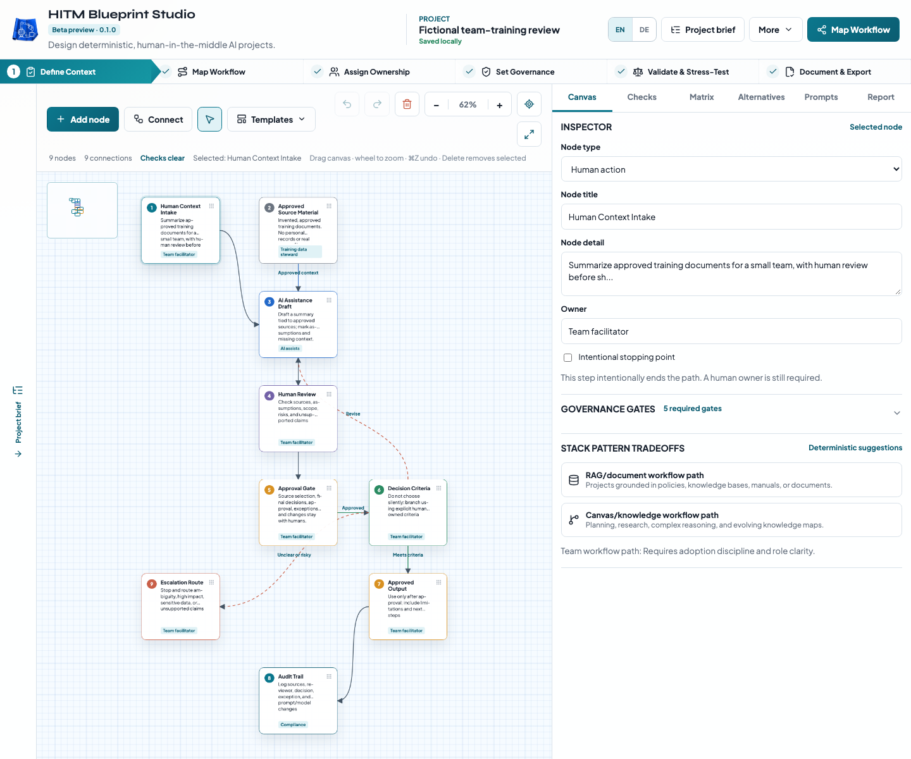

# HITM Blueprint Studio

Plan an AI-assisted project with clear human ownership, review points, and data boundaries. Turn a rough idea into an editable workflow, an ownership matrix, starter prompts, and a report you can share.

Free software by Arthur Schmidt-Pabst, licensed under MIT. [Source repository](https://github.com/SirArthur23/blueprintstudio). **Hosted public beta in preparation.** Intended app address: `https://blueprintstudio.schmidtpabst.com/`—hosting is not yet deployed or verified. Its dedicated origin isolates project storage from the Ghost sites; it does not encrypt browser storage. Export/import JSON to transfer work from localhost or preview.

## Start here

- [English manual](doc/manual.en.md) / [Deutsches Handbuch](doc/manual.de.md)
- [Privacy / Datenschutz](PRIVACY.md)
- [Release checklist](doc/release-checklist.md)

The studio is for team leads, consultants, educators, product builders, and people responsible for data and operations. You can describe your project, generate a draft or choose a template, edit the canvas, assign owners and gates, review checks, and export the result. English and German cover the interface, templates, generated prompts/reports, and Markdown exports. Your own project text stays as entered.

## What you get

- Editable workflow nodes, directed connections, branches, and revision loops.
- A guided path from project intake to governance, review, and handoff.
- Rule-based HITM checks with explanations and documented exceptions.
- Privacy-first, stronger-review, and small-team alternatives, with explicit adoption and a restorable snapshot of your previous workflow.
- JSON backups, Markdown reports/prompt packs, clipboard copying, and browser print/PDF.

The app runs locally in the browser after loading. It uses deterministic rules, not a connected AI model. It does not execute workflows or connect to operational systems. A clear check state indicates that implemented structural rules pass; people still need to review the real process, owners, data, and consequences.



Both manuals include actual English/German screenshots from isolated browsers and invented training material. [Feedback template (EN)](doc/feedback.en.md) / [Rückmeldevorlage (DE)](doc/feedback.de.md). Screenshots and templates do not send anything.

## Local use and development

Use Node.js 22.12+ (22.x), 24.x, or 26+ and pnpm 10. From this directory:

```sh
pnpm install --frozen-lockfile
pnpm dev --hostname 127.0.0.1 --port 3021
```

Open `http://localhost:3021`. No API key or environment file is needed. Export a JSON backup before switching browser, device, host, or protocol; browser storage does not travel with you.

## Verification

```sh
pnpm audit --prod --audit-level low
pnpm typecheck
pnpm lint
pnpm test
pnpm build
pnpm build:release
pnpm exec playwright install chromium firefox webkit
pnpm test:e2e
pnpm package:source
```

Unit tests exercise generation, warnings, alternatives, backup validation, and migrations. Browser tests use `/blueprintstudio/` by default; set `NEXT_PUBLIC_BASE_PATH=''` for both build and tests to verify the dedicated root deployment. Five fictional persona scenarios provide simulated task coverage. [Testing and simulation protocol](doc/testing.md) explains coverage and limits; these scenarios are not real-user UX research.

The 2026-10-13 production dependency audit is clean after the compatible security refresh. A full audit still reports one unpatched, development-only glob-parser advisory in lint tooling. See the [security audit record](doc/security-audit.md) for the exact chain, limits and publication status. Do not run tooling with untrusted configuration outside an isolated environment.

## Static hosting

```sh
NEXT_PUBLIC_BASE_PATH='' pnpm build:release
NEXT_PUBLIC_BASE_PATH='' pnpm preview:release
```

Preview the planned dedicated-origin release at `http://127.0.0.1:3031/`. The release build exports to `.next-release/` and prepares the complete handoff artifact in `out/`. See [deployment instructions](doc/deployment.md) for path configuration and release preparation. Building and previewing do not publish anything.

The app displays its beta version. Maintainer-approved public defaults point to this repository and [blueprintstudio@schmidtpabst.com](mailto:blueprintstudio@schmidtpabst.com). Build-time `NEXT_PUBLIC_BLUEPRINT_SOURCE_URL` / `NEXT_PUBLIC_BLUEPRINT_FEEDBACK_URL` can override them for a fork or self-hosted deployment; an explicit empty value disables a link. No project content is attached to those links. The app does not provision a mailbox or verify delivery. To refresh the fictional manual screenshots: build the static preview, run `pnpm manual:screenshots`, visually review, then rebuild the export.

## Contributing and roadmap

Read [CONTRIBUTING](CONTRIBUTING.md), [the conduct policy](CODE_OF_CONDUCT.md), and [security reporting](SECURITY.md). The [source of truth](doc/source_of_truth_hitm_blueprint.md) records product decisions. The optional SQL/data-source module is planned after the initial release.

This is the standalone project repository. The original development copy lives inside a larger workspace. `pnpm package:source` stages an explicit allowlist at `release/source/hitm-blueprint/`, with checksums and third-party notices. It excludes conversation history, environment files, private backups, workspace Git history, sibling projects, installed dependencies, and generated caches. The packager does not publish anything. Review the [release checklist](doc/release-checklist.md) before a hosted rollout; use only the reviewed standalone source, not the surrounding workspace.

## License and credits

Project code and original documentation: [MIT](LICENSE), copyright 2026 Arthur Schmidt-Pabst. Dependencies retain their own licenses. Bundled Plus Jakarta Sans and Syne fonts use the SIL Open Font License; see [third-party notices](THIRD_PARTY_NOTICES.md). Naming a fork must not imply that Arthur Schmidt-Pabst endorses it. No separate trademark policy has been adopted.
