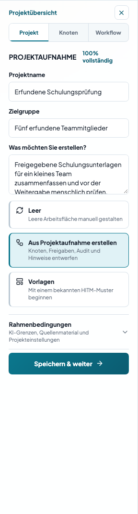
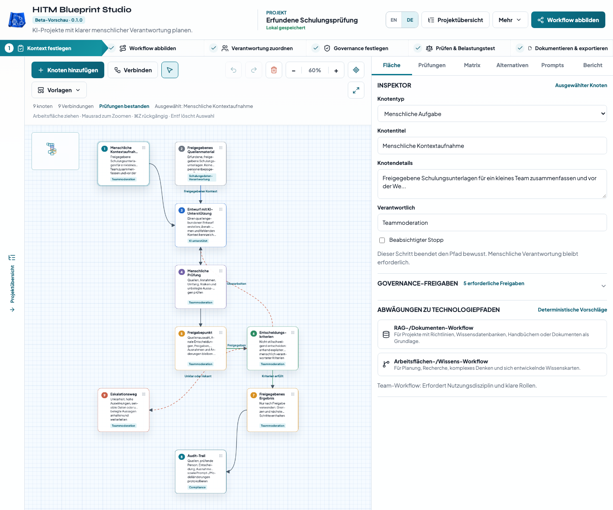
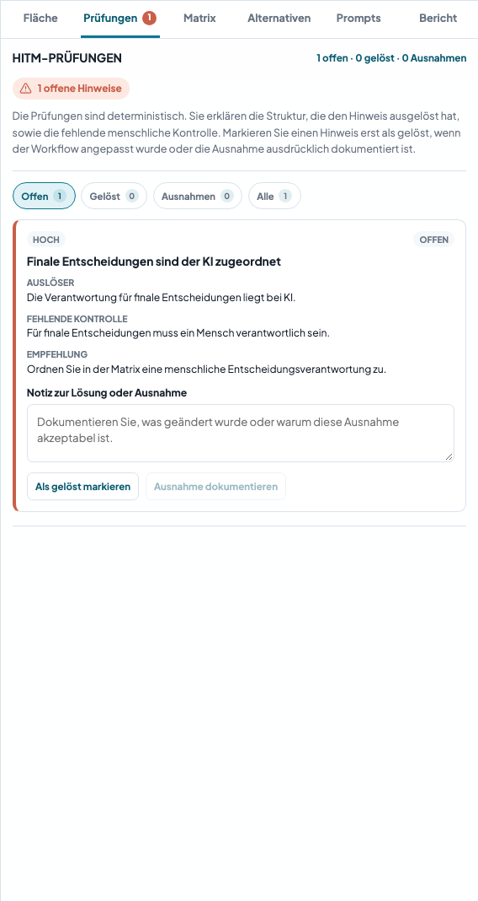
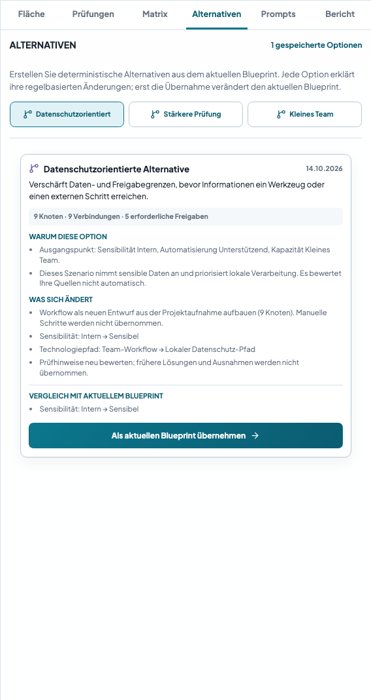
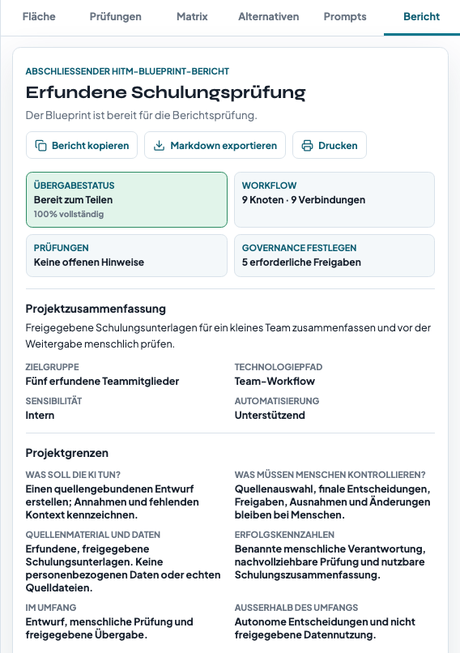
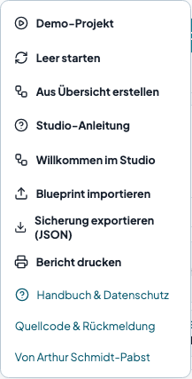

# Blueprint Studio: der erste Blueprint in zehn Minuten

Handbuch für die [öffentliche Beta](https://blueprintstudio.schmidtpabst.com/), anhand simulierter Persona-Aufgaben geprüft. Screenshots nutzen ein erfundenes Schulungsprojekt, keine Daten eines echten Teams. [Quellcode](https://github.com/SirArthur23/blueprintstudio); [allgemeine Rückmeldung](mailto:blueprintstudio@schmidtpabst.com).

## Willkommen

Ein neuer Browser ohne gespeicherten Entwurf zeigt einen kurzen Willkommensdialog. Wählen Sie English/Deutsch, **Studio erkunden** oder **Kurzanleitung zeigen**. Schließen, Escape und ein Klick außerhalb schließen ihn ebenfalls. Dabei wird kein Leerstart ausgeführt oder Projekt ersetzt. Der Browser merkt sich das Schließen nach Möglichkeit; diese Einstellung gehört nicht zur JSON-Sicherung. Vorhandene Entwürfe und Speicherfehler werden nicht unterbrochen. Erneut öffnen: **Mehr → Willkommen im Studio** oder **Studio-Anleitung → Willkommen im Studio**. Auf der öffentlichen Website erscheinen diese Bedienelemente erst nach Bereitstellung des Updates.

## 1. Eine konkrete Aufgabe beschreiben

Wählen Sie **DE** im Kopfbereich. Öffnen Sie **Projektübersicht**, dann **Projekt**. Übungsbeispiel: „Freigegebene Schulungsunterlagen für fünf Kolleginnen und Kollegen zusammenfassen.“ Tragen Sie Projektname, Zielgruppe und gewünschtes Ergebnis ein.

Öffnen Sie **Rahmenbedingungen**. Legen Sie fest, was die KI tun soll („Einen quellengebundenen Entwurf erstellen“), was Menschen kontrollieren („Quellenauswahl, finale Freigabe und Ausnahmen“) und welche Quellen verfügbar sind. Wählen Sie Sensibilität, Komplexität, Automatisierung und Kapazität bewusst. Beschreiben Sie Quellen, statt vertrauliche Originaldaten einzufügen.

Ohne gespeicherte Arbeit startet die Anwendung mit einer Demo. **Mehr → Leer starten** ersetzt das aktuelle Projekt nach Bestätigung. Exportieren Sie vorher eine JSON-Sicherung, wenn Sie den Stand behalten möchten.

## 2. Einen Einstieg wählen

- **Aus Projektaufnahme erstellen** erzeugt anhand Ihrer Einstellungen einen regelbasierten Entwurf, den Sie prüfen und anpassen.
- **Vorlagen** enthält bearbeitbare Muster für Dokumentenprüfung, Veröffentlichung, RAG, Agenten, Support und den HITM-Referenzprozess. Neu angewendete Vorlagen verwenden die aktuell gewählte Sprache.
- **Leer** erlaubt den manuellen Aufbau aller Schritte.

Generierung und Vorlagen ersetzen die vorhandene Arbeitsfläche. Sichern Sie wertvolle manuelle Arbeit vorher. EN/DE verändert die Oberfläche und neu angewendete Vorlagen; eigene Eingaben und bereits vorhandene Workflows werden nicht automatisch übersetzt.

## 3. Den Workflow anpassen

Wählen Sie einen Knoten und bearbeiten Sie unter **Fläche** Titel, Details, Typ und Verantwortung. Ersetzen Sie Rollenplatzhalter durch konkrete Personen oder bekannte Teamrollen. **Knoten hinzufügen** öffnet die Bibliothek; klappen Sie die Projektübersicht auf, falls die Bibliothek verborgen ist. Neue Knoten erscheinen in der Mitte der sichtbaren Fläche.

Aktivieren Sie **Verbinden**, wählen Sie Quelle und Ziel, und bestimmen Sie den Typ: Abfolge, Rückkopplung, Datenfluss, Eskalation, Freigabe oder Überarbeitung. Eine ausgewählte Verbindung lässt sich bearbeiten und beschriften. Pfeile zeigen die Richtung.

Verschieben Sie Knoten oder ziehen Sie den Hintergrund zum Verschieben der Ansicht. Nutzen Sie Mausrad und Zoomtasten. **Workflow einpassen** passt die Schritte innerhalb der verfügbaren Zoomgrenzen ein. **Auswahl löschen** entfernt einen Knoten samt Verbindungen oder eine einzelne Verbindung. Rückgängig/Wiederholen betrifft Arbeitsflächen-Aktionen, nicht alle Projekteinstellungen. Tastenkürzel: ⌘Z/Strg+Z und Umschalt+⌘Z/Umschalt+Strg+Z. Auf kleinen Bildschirmen öffnen Sie **Arbeitsflächen-Steuerung** für weitere Funktionen.

## 4. Verantwortung und Freigaben vereinbaren

Über die Hauptaktion oder die Schrittleiste erreichen Sie **Matrix** und **Governance festlegen**. Ordnen Sie Ziel, Prompts, Daten, Prüfung, Bereitstellung und finalen Entscheidungen menschliche Verantwortung zu. Knotenverantwortung wird separat aufgeführt; prüfen Sie beide Listen. Matrixänderungen benennen Knoten nicht automatisch um.

Wählen Sie erforderliche Governance-Freigaben und platzieren Sie entsprechende Prüf- und Freigabeknoten auf den tatsächlichen Prozesspfaden. Die Einträge sind Planungsanforderungen; die Anwendung sammelt keine Unterschriften und erteilt keine Freigaben.

Auf dem Desktop ziehen Sie die linke Inspektorkante zum Vergrößern. Bei Tastaturfokus auf dieser Kante verwenden Sie Links/Rechts, Pos1 oder Ende. Breite Tabellen und die Registerleiste können innerhalb des Inspektors horizontal gescrollt werden.

## 5. Hinweise und Ausnahmen prüfen

Mit Tab/Umschalt+Tab wechseln Sie zwischen Bedienelementen. **Mehr** und **Vorlagen** unterstützen Auf/Ab, Pos1/Ende und Escape; Tab kann die Menüs verlassen. Dialoge halten den Fokus bis zum Schließen im Dialog und geben ihn danach an das auslösende Bedienelement zurück. Beim Ersetzen eines Projekts ist zunächst „Abbrechen“ fokussiert. In den Hinweisfiltern verwenden Sie Links/Rechts und Pos1/Ende. Nach dem Dokumentieren oder Wiederöffnen eines Hinweises kehrt der Fokus zum ausgewählten Filter zurück.

Unter Safari/macOS kann für alle Bedienelemente Wahl/Option+Tab oder die entsprechende Tabulator-Einstellung in Safari nötig sein. Siehe [Apples Tastaturhinweise](https://support.apple.com/de-de/guide/safari/cpsh003/mac). Innerhalb der Studio-Dialoge durchlaufen Tab/Umschalt+Tab alle Bedienelemente direkt.

Öffnen Sie **Prüfungen**. Jeder implementierte Prüfhinweis erklärt die auslösende Struktur und fehlende Kontrolle. Ändern Sie den Workflow und prüfen Sie erneut. Filter zeigen offene, gelöste, ausgenommene oder alle Hinweise.

Der Screenshot enthält einen absichtlichen Lernfehler: Korrigieren Sie die Verantwortung für finale Entscheidungen in der **Matrix**. Eine dokumentierte Ausnahme hält eine menschliche Entscheidung fest; sie macht einen strukturell unsicheren Prozess nicht sicher.

**Ausnahme dokumentieren** verlangt eine Begründung und eine menschlich verantwortete Entscheidung. „Als gelöst markieren“ hält Ihre Feststellung fest; es beweist keine Reparatur. Öffnen Sie einen Hinweis erneut, wenn sich die Bedingungen ändern.

Bestandene Strukturprüfungen bescheinigen keine Sicherheit, Rechtmäßigkeit, Genauigkeit oder reale Freigabe. Prüfen Sie Quellenqualität, tatsächliche Zuständigkeit, Berechtigungen und nicht abgedeckte Risiken im Team.

Bei sensiblen Daten zeigen KI-/Werkzeugknoten die **Freigabe der Datennutzung**, zunächst **Ungeprüft**. Prüfen Sie erlaubtes Material, vorgesehenes Werkzeug und Datenverantwortung menschlich und dokumentieren Sie das Ergebnis. Abgelehnte oder ungeprüfte Nutzung erzeugt weiterhin einen Hinweis. Generierung erteilt keine Freigabe. **Beabsichtigter Stopp** kennzeichnet einen bewusst endenden Zweig; menschliche Verantwortung bleibt erforderlich. Weitere Regeln prüfen erreichbare Audit-/Eskalationswege, getrennte Teilabläufe, KI-verantwortete Entscheidungen und Freigabeumgehungen bei Automatisierung.

## 6. Alternativen vergleichen

Erstellen Sie unter **Alternativen** eine datenschutzorientierte Option, eine Option mit stärkerer Prüfung oder eine für ein kleines Team. Lesen Sie Gründe und Änderungen. Die Szenarien erzeugen einen neuen Entwurf aus der Projektaufnahme; manuelle Schritte werden nicht automatisch übernommen. Frühere Lösungen und Ausnahmen werden neu bewertet.

Die Erstellung verändert Ihren aktuellen Workflow nicht. **Als aktuellen Blueprint übernehmen** macht die Option bearbeitbar und speichert den vorherigen Workflow samt Einstellungen als **Vorheriger aktueller Blueprint**. Durch dessen Übernahme stellen Sie ihn wieder her. Alternativen speichern Workflow und Einstellungen; Projektname, Ziel, Quellenbeschreibung und übrige Aufnahme bleiben die aktuellen Projekttexte.

## 7. Weitergeben und wiederherstellen

Prüfen Sie **Prompts**, danach **Bericht**. Die Anwendung führt Prompts nicht aus. Generierte Texte, Qualitätsprüfungen, Berichtsbeschriftungen und Markdown-Exporte verwenden die gewählte Sprache. Bekannte mitgelieferte Standardtexte werden für die Ausgabe übersetzt; eigene Eingaben bleiben erhalten.

- **Mehr → Sicherung exportieren (JSON)** sichert das bearbeitbare Projekt samt Alternativen für Wiederherstellung und Gerätewechsel.
- **Mehr → Blueprint importieren** stellt eine gültige Sicherung wieder her. Ungültige Dateien verändern das aktuelle Projekt nicht. Ein erfolgreicher Import ersetzt es; sichern Sie diesen Stand vorher.
- **Bericht kopieren** und **Markdown exportieren** erzeugen Übergabetexte, keine bearbeitbare Projektsicherung.
- Öffnen Sie **Bericht** und nutzen Sie dort **Drucken**. Ihr Browser kann „Als PDF sichern“ anbieten; ein eigener PDF-Generator ist nicht enthalten.

Pro Browser/Origin wird ein aktuelles Projekt gespeichert. Verwalten Sie mehrere Projekte über JSON-Dateien. Andere Geräte, Browser, localhost und die öffentliche Website haben separate Speicher. Gelöschte Website-Daten können Arbeit entfernen. Bei Speicherfehlern zeigt der Kopfbereich einen Hinweis; exportieren Sie dann sofort JSON. Beschädigte gespeicherte Daten werden erst nach ausdrücklichem Neustart oder Import ersetzt.

## Beta-Informationen und Rückmeldung

Der Kopfbereich nennt Beta-Vorschau und Version. **Mehr → Quellcode & Rückmeldung** öffnet lokale Hilfe mit MIT-Urheberhinweis, GitHub-Quellcode-Link und gewähltem Rückmelde-Postfach. [Bereiten Sie eine Rückmeldung vor](feedback.de.md), mit erfundenen Daten. Keine privaten Projektexporte oder Sicherheitslücken öffentlich melden. Nichts wird automatisch versendet. Forks können diese Ziele beim Bauen ersetzen oder deaktivieren.

Weitere Angaben zu Browserspeicher, Serveranfragen und unverschlüsselten Exporten: [Datenschutz](../PRIVACY.md). Das optionale SQL-Modul folgt nach der ersten Veröffentlichung.
