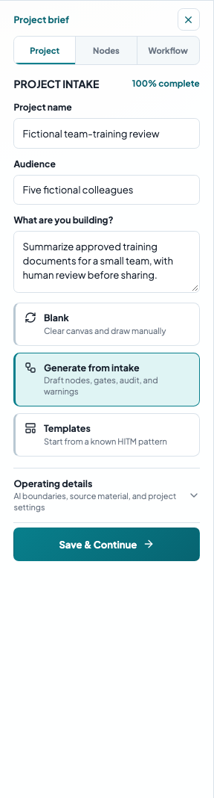
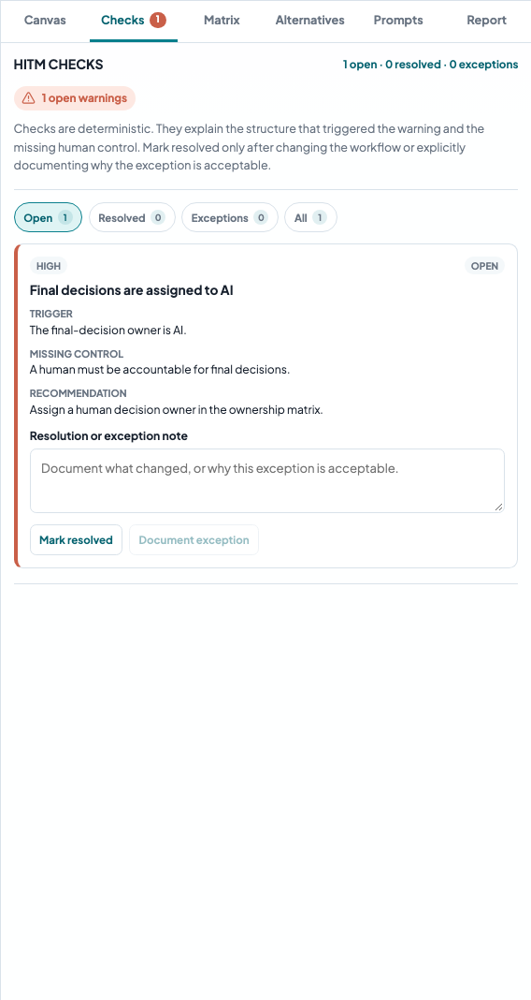
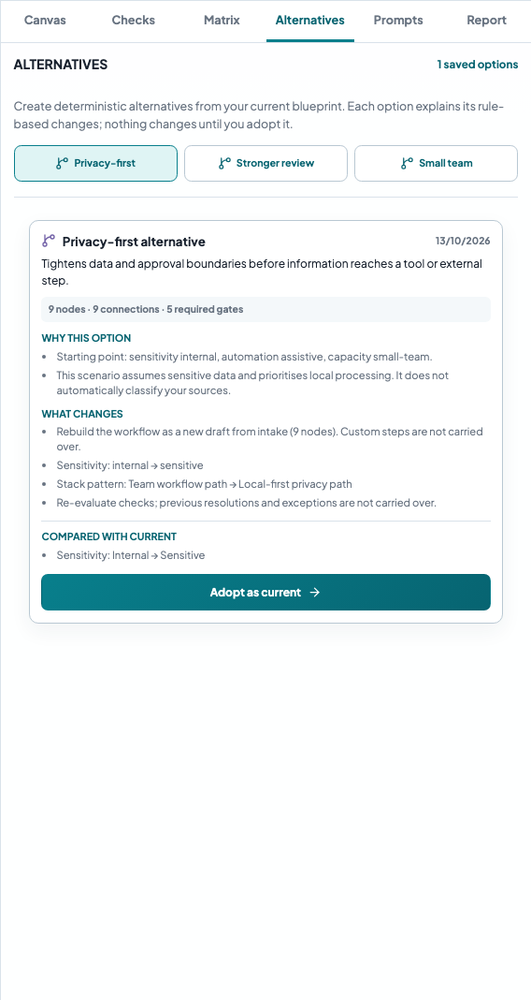
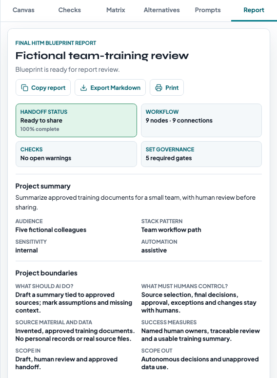
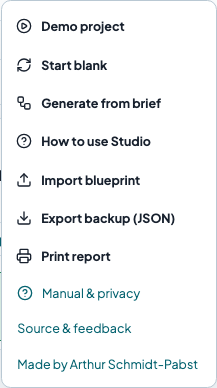

# Blueprint Studio: first blueprint in ten minutes

Manual for the beta preview, checked against scripted persona journeys. Screenshots use an invented training project, not a real team’s records. [Source repository](https://github.com/SirArthur23/blueprintstudio); [general feedback](mailto:blueprintstudio@schmidtpabst.com). Hosted rollout remains in preparation.

## 1. Describe a concrete task

Choose **EN** in the header. Open **Project brief**, then the **Project** tab. For an exercise, describe “Summarize approved training documents for five colleagues.” Enter a project name, audience, and intended outcome.

Open **Operating details**. Specify what AI may do (“Draft a summary tied to approved sources”), what humans control (“Source selection, final approval, and exceptions”), and the available source material. Choose sensitivity, complexity, automation, and team capacity deliberately. Describe sources rather than entering confidential original records.

The app starts with a demo if no local work exists. **More → Start blank** replaces the current project after confirmation. Export a JSON backup first if you want to keep it.

## 2. Choose a starting path

- **Generate from intake** creates a rule-based draft based on your settings. Inspect it as a proposal.
- **Templates** provides editable document-review, publishing, RAG, agent, support, and HITM-reference patterns. Templates use the currently selected language when applied.
- **Blank** lets you build every step yourself.

Generation and applying a template replace the existing canvas. Backup valuable custom work first. Changing EN/DE changes the interface and newly applied templates; it does not rewrite your own text or previously applied workflows.

## 3. Make the workflow yours

Select a node to edit its title, detail, type, and owner in **Canvas**. Replace role placeholders with people or roles your team recognizes. **Add node** opens the node library; expand Project brief if the library is collapsed. Adding a node places it at the visible canvas center.

Use **Connect**, select a source, then a destination. Choose sequence, feedback, data, escalation, approval, or revision. Select a connection to change its type or label. Arrows show direction.

Drag nodes to arrange them. Drag the background to pan; use the wheel or zoom buttons. **Fit workflow** fits the mapped steps as far as the available zoom range allows. **Delete selected** removes a node and its connected edges, or one selected edge. Undo/redo cover canvas operations, not all project settings. Use ⌘Z/Ctrl+Z and Shift+⌘Z/Shift+Ctrl+Z. On small screens, expand **Canvas controls** to reach secondary controls.

## 4. Agree on owners and approval points

Use the primary next-step button or stage bar to reach **Matrix** and **Set Governance**. Assign human owners for the goal, prompts, data, review, deployment, and final decisions. Canvas owners are listed separately; review both records for consistency. A matrix edit does not automatically rename every canvas owner.

Select required governance gates. Place review and approval nodes on the real paths they govern. Required entries are planning requirements; the software does not collect signatures or perform approval on your behalf.

The right inspector can be resized on desktop: drag its left edge, or focus that edge and use Left/Right arrows, Home, or End. Wide matrix content scrolls within the inspector. Its tab row also scrolls when space is limited.

## 5. Review checks and exceptions

Use Tab/Shift+Tab to move between controls. **More** and **Templates** support Up/Down, Home/End, and Escape; Tab can leave either disclosure. Dialogs keep focus inside until closed and return it to their opener. Project replacement starts on Cancel. In the check filters, use Left/Right, Home/End; documenting or reopening a warning returns focus to the selected filter.

On Safari/macOS, all-control traversal may require Option+Tab or the Safari setting “Press Tab to highlight each item on a webpage.” See [Apple's keyboard guidance](https://support.apple.com/en-gb/guide/safari/cpsh003/mac). Inside the studio dialogs, Tab/Shift+Tab cycle through all controls directly.

Open **Checks**. Each implemented rule shows the structure that triggered it and the missing control. Fix the canvas, then inspect the results. The filters show open, resolved, exception, or all records.

This screenshot contains a deliberate mistake for teaching: correct the final decision owner in **Matrix**. A documented exception records a human decision; it does not make a structurally unsafe process safe.

Use **Document exception** only with an explicit reason and an accountable human decision. A note is required. Marking a warning resolved records your assertion; it does not independently verify that the underlying problem is repaired. Reopen a record if conditions change.

Passing the implemented structural checks does not establish that the real system is safe, lawful, accurate, or approved. Review source quality, actual people, operational permissions, and any gaps outside these rules with the team.

For sensitive data, AI/tool nodes expose **Data-use approval**, initially **Not reviewed**. After human review of permitted material, the intended step/tool, and the data owner, record the result. Rejected or unreviewed use still triggers a warning. Generated drafts never grant approval. **Intentional stopping point** ends a branch deliberately and still requires a human owner. Checks inspect reachable audit/escalation paths, disconnected sub-flows, AI-owned decisions, and automated paths that bypass a gate.

## 6. Compare an alternative

Open **Alternatives** and create **Privacy-first**, **Stronger review**, or **Small team**. Read the rationale and change list. These scenarios generate a new draft from the intake; custom canvas steps are not automatically carried over. Previous check resolutions/exceptions are reevaluated.

Creating an option leaves your current workflow intact. **Adopt as current** makes it the editable working blueprint and saves the previous workflow/settings as **Previous current blueprint**. Adopt that snapshot to restore it. Alternatives store workflow/settings; project name, goal, source text, and other intake text remain the current project's text.

## 7. Share and recover your work

Review **Prompts**, then **Report**. Prompts are starting material for another tool; the studio does not run them. Generated prose, quality checks, report labels, and Markdown exports use the selected language. Recognized built-in defaults are translated for output; your own text is preserved.

- **More → Export backup (JSON)** saves an editable project, including alternatives. Use this for recovery or moving between devices.
- **More → Import blueprint** restores a valid backup. Invalid files leave the current project intact. A successful import replaces the current project, so keep a backup of that work first.
- **Copy report** and **Export Markdown** provide handoff text, not an editable project backup.
- Open **Report**, then use its **Print** button. Your browser may offer “Save as PDF.” This is browser printing, not a separate PDF generator.

Only one current project is stored per browser/origin. Export/import is how you manage separate projects. Other devices, browsers, localhost, and the public site have separate storage. Clearing site data can delete work. If saving fails, the header says so; export JSON immediately. Corrupt saved data is preserved until you explicitly start a new project or import a backup.

## Beta information and feedback

The header identifies the beta preview and version. **More → Source & feedback** opens local help with MIT attribution, the GitHub source link and the chosen feedback mailbox. [Prepare a feedback report](feedback.en.md) using fictional data; do not post private project exports or security vulnerabilities publicly. Nothing is sent automatically. Forks can override or disable these destinations at build time.

See [Privacy](../PRIVACY.md) for browser storage, host requests, and plain-text exports. The optional SQL module is planned after the initial release.
